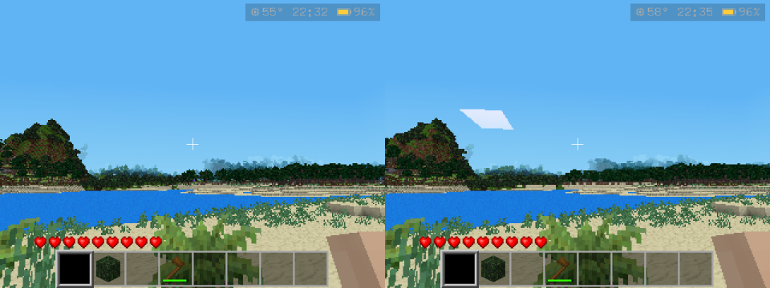
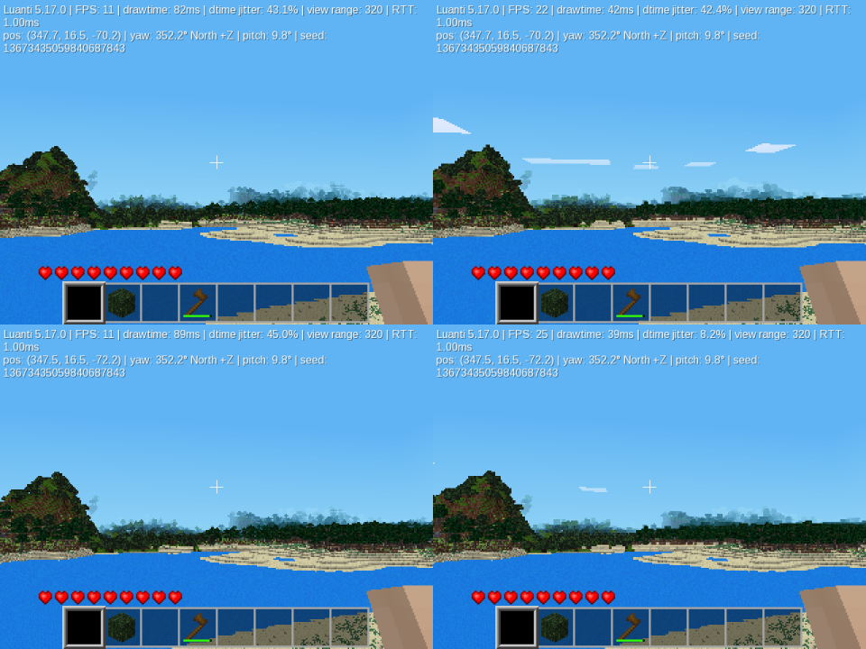
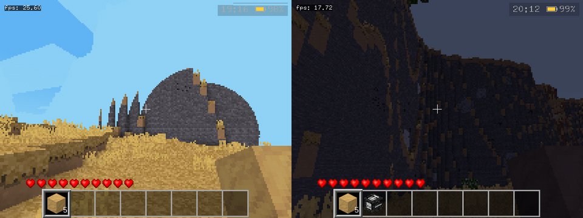

<div align="center">
    
    <h1>Luanti (formerly Minetest)</h1>
    <a href="https://github.com/luanti-org/luanti/actions?query=event%3Apush"></a>
    <a href="https://hosted.weblate.org/engage/minetest/?utm_source=widget"></a>
    <a href="https://www.gnu.org/licenses/old-licenses/lgpl-2.1.en.html"></a>
</div>
<br>

## This fork: Luanti for handhelds

`handheld/5.17` is Luanti 5.17.0 plus changes for weak hardware: an old GLES 2.0 GPU, a few hundred MB of RAM, a small screen. It is developed and measured on a GA36-MB handheld (an R36S clone: Allwinner A33, 4x Cortex-A7 at 1.2 GHz, Mali-400 through Mesa's lima driver, 512 MB of RAM, 640x480 screen), where it ships with [goodluckOS](https://github.com/alvesmaicon/goodluckOS).

This fork is not affiliated with the Luanti project. The changes were written with AI assistance (Claude). Luanti's [AI policy](doc/developing/ai_policy.md) doesn't accept that kind of contribution, so none of it is proposed upstream as a pull request. Small fixes that upstream could take are tracked as [issues labeled "upstream candidate"](https://github.com/alvesmaicon/luanti/issues?q=label%3A%22upstream+candidate%22).

### Results on the handheld

All runs use viewing range 320 and Minetest Game. Each pair uses the same world and pose.

| Scene | Without | With | What made the difference |
| --- | --- | --- | --- |
| Forest, 320x240 | 3.9 FPS, 1.64 M vertices | 28 FPS | Opaque cubes occlude, 1-mapblock meshes, leaves drawn as cubes ([#8](https://github.com/alvesmaicon/luanti/issues/8)) |
| Lake view, 320x240 | 3.4 FPS, 1.52 M vertices, 1,319 draw calls. 11 MB of RAM free, 54 MB in swap | 10 FPS, 0.53 M vertices, 560 draw calls. 177 MB free, no swap | Simplified meshes past 208 nodes |
| Lake view, 640x480 | | 10.5-11 FPS, 0.38 M vertices, 167 MB free | This branch's defaults (simplified past 160 nodes) |
| Forest, 640x480 | | 20 FPS | |



*The handheld at the lake (320x240, scaled up). Left: simplified far meshes off, 3.4 FPS. Right: on, 10 FPS. The far shore looks the same.*



*A desktop build on Mesa llvmpipe (software rendering), two moments of the same walk. Left: without simplified far meshes, 11 FPS. Right: with them, 22-25 FPS.*



*The Mali-400's fragment shaders only have fp16. Before the fog fix (left), the fog overflowed past 25.6 nodes and painted everything farther away in the sky's color, so a mountain looked like a smooth dome. After it (right), mountains show their real, jagged outline.*

### What changed

| Change | Setting (default here) |
| --- | --- |
| On KMSDRM with no cursor plane, the gamepad drives a drawn cursor in menus | |
| GLES 2.0: 2D batches drawn with `glDrawElements`, so menus have text ([#2](https://github.com/alvesmaicon/luanti/issues/2)) | |
| Text converted with UCS-4, which minimal glibc builds have built in ([#3](https://github.com/alvesmaicon/luanti/issues/3)) | |
| Fixed-size formspecs fit screens under 800x600 ([#4](https://github.com/alvesmaicon/luanti/issues/4)) | |
| Index buffers created on `GL_ELEMENT_ARRAY_BUFFER`, so lima caches their index range ([#5](https://github.com/alvesmaicon/luanti/issues/5)) | |
| Fog without overflow on mediump-only GPUs ([#6](https://github.com/alvesmaicon/luanti/issues/6)) | |
| Per-vertex fog in the nodes shader ([#1](https://github.com/alvesmaicon/luanti/issues/1)) | |
| Nodes drawn as opaque cubes occlude (leaves with `leaves_style = opaque`) | |
| Blocks out of view are unloaded too; blocks are kept alive even below 5 FPS ([#7](https://github.com/alvesmaicon/luanti/issues/7)) | `client_unload_out_of_view` (true), `client_unload_unused_data_timeout` (120) |
| Far regions of 2x2x2 mapblocks are drawn from one simplified mesh (one cube per 2x2x2 nodes, equal faces merged), with no detail meshes far away | `client_lod_distance` (160, 0 turns it off) |
| The New World dialog picks the game mode, Survival or Creative, with a button as in Minecraft, and can allow changing it in game | |
| A main menu without what needs a network or a keyboard | `menu_handheld` (true) |
| On KMSDRM, an on-screen keyboard for the gamepad types into any text field | |
| Settings open on a Video page with the render distance in chunks | `menu_handheld` (true) |
| Blocks in the inventory and the HUD hotbar take slices of the depth range instead of a depth clear each, which on lima submitted the whole frame once per block (inventory page of blocks: 138 to 33 ms a frame on the A33; in game, with a hotbar of blocks, 33 to 25 ms) | |
| The HUD (hotbar, status bars, crosshair) isn't drawn under a menu, which on a small screen covers most of it | |
| The first item of an `offhand` inventory list is held in the left hand in first person, lowered or raised by its meta field `raised` (a shield) | `offhand_position`, `offhand_rotation`, `offhand_raised_position`, `offhand_raised_rotation` |
| The wielded item is posed and swung as Minecraft draws it in first person, and an empty hand is its arm, a box with the player's skin; the hand's FOV is Minecraft's, as wide on 4:3 as on 16:9 | |
| Digging repeats the first half of the swing, every 0.2 s, and after a punch the item drops and rises as the punch reloads, as in Minecraft | |
| Place swings the hand only when something happens, as in Minecraft: a node placed, or one that opens or reacts | |
| Digging as in Minecraft: the next node 0.25 s after one breaks, five times slower off the ground and five times slower with the head in water, and the hand used when it digs faster than the tool (a creative hand) | |
| Water moves the player as in Minecraft: 1.95 m/s under water and 2.3 at the surface (it was 2.7, and 5.8 running), Minecraft's swimming as the physics override `swim` (faster, up or down where the player looks), a wall pushed on lifts the player out, flowing water pushes, and a landing in water does no damage | |
| Jumps and falls as in Minecraft: the jump 1.25 nodes high (it was 1.08), the next one half a second on while jump is held, falls as fast and a point of damage for each node beyond 3 (it was the speed over 14 m/s, nothing up to 5 nodes) | |

Every change has its reasons and measurements in its commit message. To get upstream's behavior back, set `client_lod_distance = 0` and `client_unload_out_of_view = false`.

### Settings for weak GPUs

What the handheld uses on top of the defaults:

```
viewing_range = 320
fov = 60
leaves_style = opaque
translucent_liquids = false
enable_dynamic_shadows = false
enable_post_processing = false
enable_3d_clouds = false
client_mesh_chunk = 1        # simplified meshes need 1 or 2
undersampling = 1            # 2 halves the resolution: faster, blurrier
```

### Roadmap

What is left, and what was already found out on the way: [doc/handheld/ROADMAP.md](doc/handheld/ROADMAP.md).

### Building

The same as upstream: see [doc/compiling](doc/compiling/). goodluckOS builds it for the handheld with Buildroot, applying this branch's commits as patches.

---

Luanti is a free open-source voxel game engine with easy modding and game creation.

Copyright (C) 2010-2026 Perttu Ahola <celeron55@gmail.com>
and contributors (see source file comments and the version control log)

Table of Contents
------------------

1. [Further Documentation](#further-documentation)
2. [Default Controls](#default-controls)
3. [Paths](#paths)
4. [Configuration File](#configuration-file)
5. [Command-line Options](#command-line-options)
6. [Compiling](#compiling)
7. [Docker](#docker)
8. [Version Scheme](#version-scheme)


Further documentation
----------------------
- Website: https://www.luanti.org/
- Luanti Documentation: https://docs.luanti.org/
- Forum: https://forum.luanti.org/
- GitHub: https://github.com/luanti-org/luanti/
- [Developer documentation](doc/developing/)
- [doc/](doc/) directory of source distribution

Default controls
----------------
All controls are re-bindable using settings.
Some can be changed in the key config dialog in the settings tab.

| Button                        | Action                                                         |
|-------------------------------|----------------------------------------------------------------|
| Move mouse                    | Look around                                                    |
| W, A, S, D                    | Move                                                           |
| Space                         | Jump/move up                                                   |
| Shift                         | Sneak/move down                                                |
| Q                             | Drop itemstack                                                 |
| Shift + Q                     | Drop single item                                               |
| Left mouse button             | Dig/punch/use                                                  |
| Right mouse button            | Place/use                                                      |
| Shift + right mouse button    | Build (without using)                                          |
| I                             | Inventory menu                                                 |
| Mouse wheel                   | Select item                                                    |
| 0-9                           | Select item                                                    |
| Z                             | Zoom (needs zoom privilege)                                    |
| T                             | Chat                                                           |
| /                             | Command                                                        |
| Esc                           | Pause menu/abort/exit (pauses only singleplayer game)          |
| +                             | Increase view range                                            |
| -                             | Decrease view range                                            |
| K                             | Enable/disable fly mode (needs fly privilege)                  |
| J                             | Enable/disable fast mode (needs fast privilege)                |
| H                             | Enable/disable noclip mode (needs noclip privilege)            |
| E                             | Aux1 (Move fast in fast mode. Games may add special features)  |
| C                             | Cycle through camera modes                                     |
| V                             | Cycle through minimap modes                                    |
| Shift + V                     | Change minimap orientation                                     |
| F1                            | Hide/show HUD                                                  |
| F2                            | Hide/show chat                                                 |
| F3                            | Disable/enable fog                                             |
| F4                            | Disable/enable camera update (Mapblocks are not updated anymore when disabled, disabled in release builds)  |
| F5                            | Cycle through debug information screens                        |
| F6                            | Cycle through profiler info screens                            |
| F10                           | Show/hide console                                              |
| F12                           | Take screenshot                                                |

Paths
-----
Locations:

* `bin`   - Compiled binaries
* `share` - Distributed read-only data
* `user`  - User-created modifiable data

Where each location is on each platform:

* Windows .zip / RUN_IN_PLACE source:
    * `bin`   = `bin`
    * `share` = `.`
    * `user`  = `.`
* Windows installed:
    * `bin`   = `C:\Program Files\Minetest\bin (Depends on the install location)`
    * `share` = `C:\Program Files\Minetest (Depends on the install location)`
    * `user`  = `%APPDATA%\Minetest` or `%MINETEST_USER_PATH%`
* Linux installed:
    * `bin`   = `/usr/bin`
    * `share` = `/usr/share/minetest`
    * `user`  = `~/.minetest` or `$MINETEST_USER_PATH`
* macOS:
    * `bin`   = `Contents/MacOS`
    * `share` = `Contents/Resources`
    * `user`  = `Contents/User` or `~/Library/Application Support/minetest` or `$MINETEST_USER_PATH`

Worlds can be found as separate folders in: `user/worlds/`

Configuration file
------------------
- Default location:
    `user/minetest.conf`
- This file is created by closing Luanti for the first time.
- A specific file can be specified on the command line:
    `--config <path-to-file>`
- A run-in-place build will look for the configuration file in
    `location_of_exe/../minetest.conf` and also `location_of_exe/../../minetest.conf`

Command-line options
--------------------
- Use `--help`

Compiling
---------

- [Compiling - common information](doc/compiling/README.md)
- [Compiling on GNU/Linux](doc/compiling/linux.md)
- [Compiling on Windows](doc/compiling/windows.md)
- [Compiling on MacOS](doc/compiling/macos.md)

Docker
------

- [Developing minetestserver with Docker](doc/developing/docker.md)
- [Running a server with Docker](doc/docker_server.md)

Version scheme
--------------
We use `major.minor.patch` since 5.0.0-dev. Prior to that we used `0.major.minor`.

- Major is incremented when the release contains breaking changes, all other
numbers are set to 0.
- Minor is incremented when the release contains new non-breaking features,
patch is set to 0.
- Patch is incremented when the release only contains bugfixes and very
minor/trivial features considered necessary.

Since 5.0.0-dev and 0.4.17-dev, the dev notation refers to the next release,
i.e.: 5.0.0-dev is the development version leading to 5.0.0.
Prior to that we used `previous_version-dev`.
