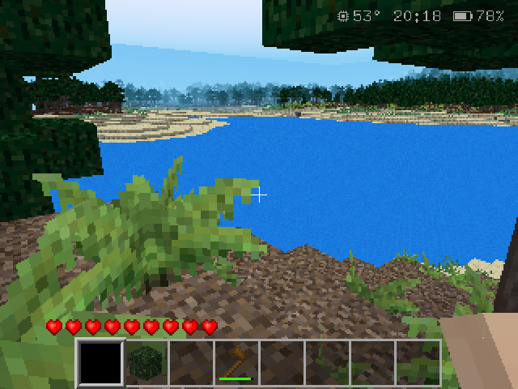
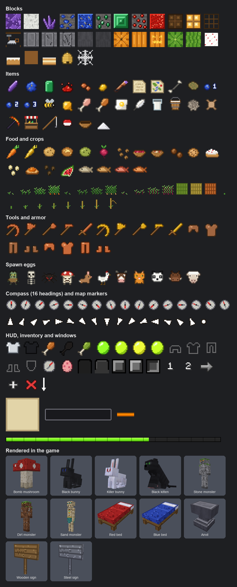

# Luanti for goodluckOS



Luanti is an open-source engine for Minecraft-like games, and Minetest Game, its classic game, is free. Here both run on a 512 MB handheld with a Mali-400: 47 patches make the engine fast enough, fit it to a gamepad and a 640x480 screen, and make it dig, swim, jump and hold things as Minecraft does, and 66 mods, 49 of them written for goodluckOS, bring the game close to Minecraft: Survival or Creative, hunger and status effects, armor and shields, Minecraft's ores, crops and foods, the classic monsters and the witch, iron and snow golems, the illagers (pillagers with crossbows, their patrols and outposts, vindicators, evokers and their vexes, ravagers, raids, woodland mansions, the totem of undying), villages with traders, horses, experience, enchanting and the anvil, a bow, a compass, maps and a spyglass, recipes learnt as you go, the Nether with its fortresses, potions and the brewing stand, swamps with witch huts, the End with its strongholds, the ender dragon, its outer islands, gateways and cities with their ships and shulkers, and the elytra with firework rockets. At 640x480: 20 FPS in a forest, 10 to 11 looking across a lake, capped at 30. It comes with free textures and sounds, or takes the textures, sounds and music of your own Minecraft: Java Edition, which the app's Minecraft look for Luanti imports from a copy of your `.minecraft` folder ([Installing and updating Luanti](#installing-and-updating-luanti)); nothing of Minecraft's is in this repository or in the image.

**Install:** Luanti is an app for the App Installer, one zip: copy it to the `apps` folder of HOME and install it in System Settings -> System -> App Installer ([below](#installing-and-updating-luanti)), and it shows up in the Games tab. Worlds and settings are kept in `HOME/.minetest`. The controls, and how each part of the game plays, are [below](#playing).

## Playing

### Worlds and settings

Luanti opens on its world list, laid out as Minecraft's Select World: each world with a picture of it as it was last left (taken when the pause menu opens, or when START+SELECT closes the game), its name, when it was last played, its seed, game mode, difficulty and type, the latest played on top. A press picks a world and a second one plays it; the right stick scrolls past four worlds. Under the list are Play Selected World, Create New World, Rename, Delete, Re-create (New with that world's choices already filled in) and Exit.

Create New World is laid out as Minecraft's, in three tabs, with a switch for each option that is on or off:

- **Game:** the world's name (left empty, it takes the next free one), its game mode, Survival or Creative, its difficulty and whether the game mode can be changed in game. Peaceful has no monsters and no hunger; Easy halves the monsters' health and damage and starvation stops at 10 HP; Normal starves down to 1 HP; Hard adds half to the monsters and starvation kills, as in Minecraft.
- **World:** the world type, its seed (left empty, a random one; the same seed makes the same world), whether it has structures (villages, witch huts, ruined portals, Nether fortresses, strongholds and End cities; without strongholds there is no end portal, as in Minecraft) and whether it starts with a bonus chest. The types are Default, Superflat, Large biomes (four times as wide), Amplified (higher hills and mountains; it is heavier on the console), Single biome, and Luanti's Valleys and Carpathian; Customize turns caves, decorations (trees and plants), dungeons and the type's own features on or off, and picks the single biome.
- **More:** Minecraft's game rules: keep the inventory after death, the daylight cycle, mobs spawning, fire spreading, mobs changing blocks (creepers, endermen and snow golems) and natural regeneration.

A world made with "Bonus chest" switched on starts with a chest by the spawn, on open level ground (not on a tree, under one or against a slope), torches around it, holding a map of the place, a stone pickaxe and axe, apples, bread, sticks, planks, logs and torches.

As in Minecraft, Creative mode lets you fly, breaks blocks at once and has no damage, hunger or monster attacks. Survival has farm animals and monsters that come out in the dark. With "Allow changing the game mode" switched on, a toggle in the inventory switches between the two (a grass block in Creative, a sword in Survival, as in Minecraft's game mode switcher).

A world opens only once the terrain in view is loaded and drawn, as far as the view goes (up to 320 blocks), so it doesn't show building itself; a new world has to be made first, which can take up to a minute.

Luanti's settings (the gear on the main menu, or START > Settings in a game) open on Video, the render distance as in Minecraft: 4 to 20 chunks of 16 blocks. Fewer chunks make the game faster, and a change made in a game shows at once.

### Controls

The console has no mouse cursor, so whenever a menu or the inventory is open, Luanti draws one that the left stick moves; the right stick scrolls. In the inventory and in a chest the buttons work as on Minecraft Bedrock: B (bottom) takes the whole stack, Y (left) half of it, and X (top) sends it straight to the other side, from the chest to the inventory or back (from the crafting output, as many as it can make).

Clicking a text field (a world's name, a setting, a sign, a book, the creative inventory's search) opens the launcher's keyboard: the D-pad moves between keys, B types, A deletes (and closes it when nothing is left), OK or START closes it (in the creative inventory's search, that searches), SELECT closes it and puts the old text back, L1/R1 move the cursor in the text.

| Buttons | In game | In menus and the inventory |
|---|---|---|
| Left stick | Walk | Move the cursor |
| Right stick | Look around | Scroll (lists with a scrollbar, wherever the cursor is) |
| B (bottom) | Jump (on a horse: held, it charges the jump bar; let go to jump) | Click (on a text field: the keyboard) |
| A (right) | Sneak (with a shield on: hold it up; on a horse: get off) | Back |
| X / Y | Inventory | Y: half a stack, X: the stack straight to the other side |
| R1 / L1 | Dig, eat, look through the spyglass (held) / place, throw a snowball, draw a bow (held; let go to shoot), load a crossbow (held) and shoot it (L1 again), hold a worn shield up (no block in hand), get on a horse (with A held: its inventory) | Scroll |
| R2 / L2 | Next / previous item | |
| L3 | Run, until the stick is let go | |
| D-pad | Up: camera view (seen from outside, the player holds what's in hand), down: drop the item, left: fly (Creative mode), right: screenshot | Move the cursor slowly |
| START | Pause menu (Exit to OS goes back to the launcher) | Close |

### The view, the hand, jumping and swimming

What you hold is drawn and swings as in Minecraft too, with nothing in hand your arm with your skin: a quick chop toward the crosshair that keeps going while you dig, and after a hit it drops and rises back as the next hit charges up. Taking something else in hand lowers one and raises the other, placing a block makes the hand dip, and walking bobs the view and the hand, all as in Minecraft. As in Minecraft, pointing at a block shows no text (a sign still shows what is written on it), and villagers carry no name over their heads: the trade window says who they are.

Running widens the view a little, as in Minecraft. Jumps and falls are Minecraft's too: a jump goes a block and a quarter high, no higher against a block, a slab or a stair, jump held jumps again after half a second, and a fall costs half a heart for each block beyond three.

Water works as in Minecraft too: under water you walk at half the speed and sink slowly, jump swims up and sneak down, and running or jumping no longer carries you over the surface; running (L3) with the head under water swims, lying face down, faster and up or down where you look, through holes one block high (out of the water you crawl until there is room to stand), and with the feet in water and the head out you can't run. Pushing on a wall at the surface lifts you out over an edge up to a slab above the water (not a whole block, as in Minecraft), from a stream or the foot of a waterfall jump takes you onto a bank a block high, flowing water carries you along, a fall into water does no damage, and the breath lasts 15 seconds under water, then costs a heart every second, and comes back in 4 seconds.

### Digging, items and chests

Blocks take as long to break as in Minecraft, by their hardness and the tool: stone by hand takes seven and a half seconds and gives nothing, a pickaxe too weak for an ore breaks it slowly and gets nothing either, the next block comes a quarter of a second after one breaks, and digging is five times slower in the air (jumping, flying, on a ladder) and five times slower again with the head under water; tools last as long as Minecraft's. A broken block falls to the ground, as in Minecraft, and walking past an item picks it up; one you drop (D-pad down) only after two seconds, so it isn't picked right back, and R1 still picks one up from afar. What lies on the ground goes away after five minutes.

Two chests side by side make one big chest of 64 slots, as in Minecraft (a third one beside them stays a chest on its own); it shows 32 at a time, with tabs 1 and 2 above it. Chests, beds, signs and the minecart have Minecraft's shapes, so that its textures fit them: the chest a pixel in from every side with its lid and latch, the bed on four legs, the sign on a post when it stands on the floor (turned the way you look, in sixteenths of a turn), the minecart's iron box; without Minecraft's own files they wear Pixel Perfection's chest and minecart and goodluckOS's own bed and sign. There are no keys, as in Minecraft: a locked chest opens for its owner, and a key from before became the gold ingot it was made of.

### Ores and metals

- Ores come as in Minecraft before 1.18, in ground not generated yet: coal, iron, copper (as in 1.17), gold, diamonds, lapis lazuli and redstone in veins of its sizes, as many and at its heights counted from sea level (copper from 34 nodes above it down, iron from sea level down, gold and lapis from 30 nodes under it, diamonds and redstone from 46), and on down below the depth where a Minecraft world ends.
- Emeralds come as in Minecraft before 1.18 too, single ones from 31 to 58 nodes under sea level, and only under the cold forests, the nearest this game has to Minecraft's mountains.
- Lapis lazuli is an ore from 30 nodes under sea level down, only in ground not generated yet, 4 to 9 from each.
- Redstone takes the place of Minetest Game's mese: its ore gives 4 or 5 redstone dust and glows a while when punched, and the dust makes its block, the compass and the powered rail (six gold ingots around a stick, the dust under it) as in Minecraft.
- There are no circuits yet: a block of redstone lights a redstone lamp next to it, made as in Minecraft from four redstone dust around glowstone from the Nether.
- Copper takes the place of tin and bronze: its ore gives 2 to 5 raw copper, and copper makes Minecraft's copper tools, hoe and armor (between stone and iron, as since Minecraft 1.21.9) and nuggets.
- Gold makes golden tools, the fastest of all but worn out after 32 blocks, and they get from a block only what wood does.
- Copper and golden tools and armor melt down to a nugget in the furnace.
- Amethyst comes from geodes, as in Minecraft: hollow balls in the stone between 16 and 160 nodes down, calcite outside and amethyst inside, whose clusters give four shards to a pickaxe (two otherwise), and four shards make a block of amethyst.
- Minetest Game's binoculars are Minecraft's spyglass now, made at the crafting table from an amethyst shard over two copper ingots; in hand, R1 held (the button that eats) looks through its round lens.

In a world from before, mese became redstone, mese lamps lit redstone lamps and mese tools diamond ones; tin and bronze became copper, and bronze tools and armor copper ones.

### Farming, food and fishing

- Crops grow on dry farmland too, at about half the speed of wet farmland, and by night under the open sky; picked before they are ripe they give their seed back.
- Carrots, potatoes and beetroots grow as in Minecraft: a carrot or a potato is planted itself, beetroots from their seeds; village fields grow them now and then in place of wheat, and a zombie may drop a carrot or a potato.
- Baked potatoes, mushroom stew and beetroot soup (in a bowl, three planks), sugar from papyrus, gold nuggets and the golden carrot (eight nuggets around a carrot) are made as in Minecraft, and each food fills Minecraft's hunger points; a poisonous potato, one in fifty from potatoes, often poisons.
- Pumpkins and melons grow on a stem from their seeds, which sets its fruit on the dirt beside it, bends to it and sets another once it is taken; pumpkins also grow wild in small patches on the grass, melons in the rainforest.
- Cocoa pods hang on the lower trunk of some jungle trees and ripen from green to brown; a ripe one gives three cocoa beans, which grow a pod again on a jungle trunk and make cookies (two wheat around a bean, eight of them) and brown dye.
- The cake (three milk buckets, two sugar, an egg and three wheat) is placed and eaten in seven bites, only when not full; broken, it gives nothing.

Shears used on a pumpkin (L1) carve a face in it, on the side you point at, and four pumpkin seeds fall out, as in Minecraft; a carved pumpkin over a torch makes a jack o'lantern, and a pumpkin, sugar and an egg a pumpkin pie. A carved pumpkin also goes in the helmet's slot: it protects nothing and never wears out, others see it on your head, and you look out through its eyes (in the third-person views too, which the game can't tell apart).

The fishing rod (three sticks and two strings) casts a bobber; on water, a fish bites after 5 to 30 seconds and the bobber dips with a splash for about a second, and reeling in then (the same button) catches, as in Minecraft, cod, salmon or pufferfish most of the time, now and then junk (a lily pad, a bowl, leather, a bone, a stick...) or treasure (a bow, a name tag, a saddle, a rod), with a little experience; the rod lasts 64 catches. Cod and salmon are eaten raw or cooked.

### Animals

As in Minecraft, most animals come with the land, a herd of four sheep, pigs, chickens or cows here and there on the grass, and they stay where they are when you walk away. Rats and penguins, which Minecraft hasn't, are gone; in a world from before they leave, and their items became chicken.

The cow, the pig, the sheep, the chicken, the horses and the spider have Minecraft's shapes too: they walk, run, eat grass, rear and fall on their side when they die as Minecraft's do, in Pixel Perfection's coats without Minecraft's files. None of them fights back any more (one that is hit runs away), the warthog became the pig, and wool takes Minecraft's colours.

### Horses, donkeys and mules

Horses are Minecraft's: herds of two to six in grassland and savanna, now and then with a foal, in seven coats (white, creamy, chestnut, brown, black, gray, dark brown) with or without white socks and a blaze, white patches, white or black dots, and each with health, speed and jump of its own. A wild horse is tamed by getting on it (L1 with an empty hand): it throws you off a few times, each time a little calmer, and wheat, apples and golden apples calm it faster, until it keeps you and hearts show. Only a saddle lets you steer it (three leather over an iron ingot, or from village chests and dungeons); sneaking (A) gets you off. Holding jump (B) fills the jump bar where the experience bar is, and letting go jumps higher the fuller it is, up to five blocks for the best horses.

Horse armor, leather (seven leather, and it takes a dye's colour), iron, gold or diamond (these only from village chests and dungeons), takes 12 to 44 % off the damage. A horse's inventory, with its saddle and armor slots, opens from the inventory while riding, or with A held and L1 on it. A golden apple (eight gold ingots around an apple) to each of two tamed horses makes a foal, with health, speed and jump between theirs; wheat, apples, golden apples and straw make foals grow faster.

Horses run 5 to 9 blocks a second, slower than Minecraft's fastest (14.6); `goodluck_horse_max_speed` in minetest.conf sets the top. Now and then a herd is of one to three donkeys instead: gray, smaller and slower (6 blocks a second, low jumps), tamed and saddled the same way but with no armor; a chest on a tamed donkey gives it 15 slots on its page, for good. A horse and a donkey fed golden apples make a mule, which carries a chest too but has no foals.

### Monsters

Monsters appear only where no torchlight reaches, as on Minecraft since 1.18: a torch keeps its whole glow clear, not just the bright part; as on Bedrock, up to 8 under the open sky and 6 in caves around the player, so a cave below doesn't keep them from the surface, and those left far behind go away as on Java. Slow as Minecraft's, they chase at half the speed of a walking player.

The monsters are Minecraft's classic ones, in its shapes, and every few seconds you hear them from 16 nodes away: the zombie's groan, the skeleton's rattling bones, the spider's hiss. The zombie comes with its arms out and the skeleton shoots arrows, and both burn in the sun; zombies drop rotten flesh (it feeds 4, but often leaves you hungrier soon after), skeletons bones (a bone makes three white dye) and arrows, now and then their bow. The spider leaves you be in daylight unless you hit it, and drops string. In the creeper's place there is the bomb mushroom: it creeps up without a sound, swells and puffs spores, and blows up, leaving a crater; killed first, it drops gunpowder.

The witch is Minecraft's too, rarer than the others in the dark: she keeps about ten blocks from you and throws a splash potion every three seconds, Slowness when you are far, Poison while you are healthy, now and then Weakness up close, Harming otherwise. She drinks one when she needs it, slowing down meanwhile, her nose up with the bottle: Healing when hurt, Fire Resistance on fire, Water Breathing under water, Swiftness to catch up. Magic hurts her little, and her own potions not at all. She drops redstone, and a few of glowstone dust, sugar, spider eyes, glass bottles, gunpowder and sticks; killed while drinking, now and then the potion too.

### Golems

The golems are Minecraft's, in its shapes. A carved pumpkin or a jack o'lantern put last on two snow blocks makes a snow golem, and on a T of four blocks of iron (one under, three across, with nothing beside its head or its legs) an iron golem; the blocks turn into it.

The iron golem has 100 of health, takes no knockback and no fall damage, and goes after every monster it sees within 16 blocks but the bomb mushroom (as Minecraft's leaves the creeper alone): it throws both arms up and hits for 7 to 21, tossing what it hits into the air. Cracks show on it as it loses health, and an iron ingot (L1) mends a quarter of it. One you built never turns on you; any other goes after whoever hits it. Every village has one by its crossroads, which stays near the village, and its villagers call another when they panic ([Villages](#villages)). It drops 3 to 5 iron ingots and up to 2 roses.

The snow golem goes after every monster it sees within 16 blocks, comes up to 10 away and throws a snowball a second. A snowball hurts only a blaze, but pushes what it hits and sets it on the thrower, so monsters go after the snow golem, which never hits back at anything but a monster. Deserts, savannas, the Nether and water melt it, and where it is cold (snowy places, taiga and forests) it leaves snow behind it, unless mobs may not change blocks. Shears (L1) take its pumpkin off. It drops up to 15 snowballs.

Snow gives snowballs, as in Minecraft: a snow block 4 and a layer 1, to a shovel; four make a snow block again, three blocks make six layers, and L1 throws one.

Mobs go after each other as Minecraft's do: the zombie and the illagers after players, villagers and iron golems; the skeleton, the wither skeleton, the spider and the magma cube after players and iron golems; every other monster after players only. A mob hit by another one, or by its arrow, fireball or snowball, goes after it: a skeleton's stray arrow sets a zombie on the skeleton, and an iron golem's hit sets the zombified piglins on it. In Creative nothing hurts you, and the monsters still fight the golems and each other, so a battle can be set up with spawn eggs and watched.

### Illagers and the crossbow

Pillagers are Minecraft's, with 24 of health and a crossbow. They go after players, villagers and iron golems up to 32 blocks away: a pillager comes within 8 blocks, loads its crossbow (a second and a quarter), waits one to two seconds and shoots, for 3, 4 or 5 by the world's difficulty, and its arrows pass through other pillagers. Iron and snow golems go after them, and villagers run from one 15 blocks away. They drop up to two arrows and now and then their crossbow.

They come in patrols, as in Minecraft: from the fifth day, now and then by day, two to four of them (by difficulty) come out in the open 24 to 48 blocks from you, away from villages, led by a captain who wears the ominous banner on its head. The captain walks off toward a point far away, and the others keep up with it. Pillager outposts stand in plains, savannas, deserts, the taiga and snowy lands, never by a village: a dark wood tower of three floors with a ladder inside and a roofed lookout on top with a chest (a crossbow, arrows, string, iron, wheat, carrots, potatoes and logs), now and then a caged iron golem by it, and pillagers keep coming at it while you are near, a few of them captains.

A captain drops the ominous banner and an ominous bottle of level I to V. Drunk (L1), the bottle gives Bad Omen at its level for 100 minutes, which brings a raid on the next village you walk into.

The vindicator has 24 of health and an iron axe that hits for 13 (half on Easy, half again on Hard), and goes after players, villagers and iron golems 12 blocks away, its arms crossed until then. Named Johnny with a name tag, it goes after every mob but the illagers, as in Minecraft.

The evoker has 24 of health and no weapon: it runs from you when you come within 8 blocks, and casts with its arms up. It calls three vexes when fewer than eight are about (again 17 seconds later), and between them sends fangs out of the ground at its target, every 5 seconds: a line of 16 toward it, or two rings round itself when the target is within 3 blocks; fangs bite 6 into whoever stands on them but the illagers. With nothing to fight, it turns a blue sheep within 16 blocks red, as Minecraft's wololo does. It drops the totem of undying. Vexes, 14 of health, fly through blocks and charge with an iron sword for 9, flying off a moment after each hit, and wither away after 30 seconds to two minutes.

The ravager has 100 of health and is hardly pushed back; its bite does 12 and throws what it hits away. It goes after players, villagers and iron golems 32 blocks away, steps up a block and breaks through leaves in its way, and drops a saddle. Vindicators, evokers and ravagers come in raids, vindicators and evokers live in woodland mansions, and all have spawn eggs in Creative.

The totem of undying, held in the hand, takes the blow that would kill you: your health comes back to 1, your effects go, you get Regeneration II for 45 seconds and Fire Resistance for 40, and the totem is used up, with a burst of green and yellow.

Raids are Minecraft's: walking into a village with Bad Omen turns it into Raid Omen, and 30 seconds later the raid begins (milk before that stops it). Its waves come one at a time, 15 seconds apart, from about 32 blocks away: 3 on Easy, 5 on Normal, 7 on Hard, and one more when the omen was over I, each with Minecraft's mix of pillagers, vindicators, evokers, witches and ravagers (the fifth wave's ravager ridden by a pillager, the seventh's by an evoker and a vindicator) and its first illager with the banner. The raiders march on the village and go after its villagers, golems and you, while the villagers go home as they do at night. A red bar at the top shows the raiders' health left and fills while the next wave comes. When the last wave is down, everyone within 96 blocks has Hero of the Village for 40 minutes (its trading discounts aren't in yet); with no villager left the raid is lost. On the handheld, at most 10 raiders are out at once, and the rest of a wave comes as they fall.

Woodland mansions are drawn for this game (Minecraft builds its own from pieces that aren't free) and are as rare: they stand in the deciduous forest, the nearest this game has to the dark forest. Dark wood on a cobblestone footing, three floors under a stepped roof, log pillars and glass panes outside; inside, two halls cross each floor with four rooms off them and a ladder up the east end: guard rooms with two vindicators, spell rooms where an evoker waits on a circle of wool, libraries, bedrooms, store rooms and a dining room, and chests with Minecraft's mansion loot (golden apples, a diamond hoe or chestplate, iron, gold, redstone...). Its illagers never despawn and come back when they wander off. In the chat, `/mansion` and `/outpost` build one where you stand.

The crossbow is Minecraft's: three sticks, two strings and two iron ingots (one where Minecraft has a tripwire hook). Holding L1 a second and a quarter loads it with an arrow from the inventory (Creative needs none), walking as slow as sneaking, and letting go sooner leaves it empty; loaded, it keeps the arrow until L1 shoots it, faster than a bow's full draw, for 7.

### Status effects

Status effects work as in Minecraft: Speed, Slowness, Jump Boost, Slow Falling, Poison, Wither, Regeneration, Strength, Weakness, Fire Resistance, Water Breathing, Invisibility, Night Vision and Hunger, each with a level and a time, show as Minecraft's icons at the top right, under the status bar and the compass's position (the harmful ones a row lower) with the time left under each, blinking in the last 10 seconds, and as swirls of their colour around the player. Poison turns the hearts green and never takes the last half heart, Wither turns them black and can kill. Milk takes every effect away, and so does dying; they last over leaving the world and coming back.

Rotten flesh (Hunger), the poisonous potato and the spider eye (Poison, 5 seconds), the pufferfish (Poison and Hunger), the wither skeleton (Wither) and potions give them; Night Vision lights up everything you see, as bright as in full light, and flickers in its last 10 seconds as in Minecraft. Rotten flesh turns the hunger bar green for 30 seconds, as Minecraft's Hunger effect, and hunger drains a little faster meanwhile. `/effect <name> [seconds] [level]` in the chat gives one, and `/effect clear` takes them away.

### Armor and the shield

Armor is Minecraft's too: leather armor (from cows' leather) in place of wood and cactus armor, and one shield, Minecraft's (six planks and an iron ingot), in place of eleven, with no armor points of its own and Minecraft's uses. A shield, worn with the armor, is held in the left hand, lowered at the bottom left, and blocks as in Minecraft: held up, hits and arrows from the front do no damage and wear only the shield, the monster that hit it is pushed back, and you walk as slow as sneaking. L1 holds it up when there is no block in hand (with a block, L1 still places it, as Minecraft's main hand comes first), and so does sneaking, as on Bedrock; attacking lowers it, as on Bedrock too.

### Experience, enchanting and the anvil

Experience works as in Minecraft: mining coal, lapis lazuli, emerald, redstone or diamond ore, killing a monster (5 points) or an animal (1 to 3), and taking what the furnace made give green orbs that fly to you and fill the bar above the hotbar, with the level in the middle; a chime marks every fifth level. Dying loses the levels and leaves 7 points a level, 100 at most, in your bones (on the ground when there are none), and they come back to you when you empty them.

The enchanting table, crafted as in Minecraft from a book, two diamonds and four obsidian, enchants tools and swords: each of its three choices costs 1 to 3 lapis lazuli and as many levels, and asks for the level written on it, and up to 15 bookshelves around the table raise the choices to level 30. An enchanted item shines as in Minecraft, a purple sheen drifting over it in the inventory and in the hand. Fortune works as in Minecraft, on ores only, Silk Touch gives no experience, and the grindstone takes enchantments off.

The anvil works as in Minecraft: three blocks of iron over an ingot over three ingots make one, and a village's blacksmith has one on its porch, by the armorer. Its window renames an item for 1 level (the name box takes the on-screen keyboard, and its OK applies the name) and repairs a tool or armor with its material, a quarter of the durability and 1 level for each plank, cobblestone, leather, ingot or diamond, or with another of its kind: both durabilities and 12 % more, for 2 levels, and their enchantments joined (equal levels go one up, otherwise the higher stays, and Fortune and Silk Touch don't mix). Each use of an item makes its next one dearer, and past 39 levels it is Too Expensive, though a rename alone never is; Creative pays nothing. One use in eight chips the anvil, the next such use damages it and the one after breaks it, and it falls like sand.

### The bow

The bow works as in Minecraft: crafted from three sticks and three strings, it draws while L1 is held and shoots when L1 is let go; a full draw takes a second and does 6, a short one less, and a tap sends nothing. Drawing walks as slow as sneaking. Arrows come from the inventory, four from a flint, a stick and a feather (chickens drop them), and one stuck in a block is picked up by walking into it. The enchanting table gives a bow Power, Punch or Infinity, as in Minecraft.

### Villages

Villages appear in ground not generated yet, as in Minecraft: gravel roads crossing at the middle, houses, a blacksmith (an anvil on its porch), a church, a library and wheat fields, with loot in the chests. Houses stand on their stone floor a block over the ground, at the height of the road before their doors (a block up where their ground is higher), with the ground around them sloped so no wall of earth shuts them in, and the roads climb or drop one block at a time.

A villager lives in each house with a bed, and traders stand at work, each in the clothes of its trade as in Minecraft: the armorer (iron and diamond armor, the shield), the toolsmith (enchanted tools and swords), the cleric (lapis lazuli), the librarian (bookshelves and books) and the farmer. They are paid in emeralds, at Minecraft's prices, and each one also buys something (coal, iron, paper, wheat...) for emeralds.

At dusk the villagers walk home, opening the door and closing it behind them, and sleep in their beds until morning, when they come out again; by day they stay near home. A villager from an older village takes the nearest free bed. Villagers don't fight, as in Minecraft: they run from a zombie that comes within 8 blocks or an illager within 10 to 15, and every village has an iron golem by its crossroads that does it for them ([Golems](#golems)). A raid sends them home too. When they panic (a zombie near, or a hit), three to five of them that slept the night before and haven't seen an iron golem for half a minute call one.

### Swamps and witch huts

Swamps appear in ground not generated yet, as in Minecraft: low wet land by the water in warm and humid places, its grass and leaves in Minecraft's dark swamp colours, water standing in its hollows, swamp oaks hung with vines you can climb, lily pads, blue orchids, mushrooms and papyrus. Here and there a witch's hut stands in one on its stilts, as Minecraft's: a witch and a black cat live in it, with a crafting table, a potted red mushroom and a cauldron holding a few potions. The witch stays even when you go away, and when she is killed another one comes some minutes later, as on Bedrock.

The cauldron (seven iron ingots) is Minecraft's too: a bucket of water fills it and an empty bucket takes the water back, and, as on Bedrock, it keeps up to three bottles of one potion or of water; a bottle puts one in, an empty bottle takes one out, and another kind spoils what is in it.

### The compass and maps

The compass, four iron ingots around redstone dust, points to the world's spawn in the inventory and in the hand, and while held it shows where you are at the top right, under the status bar.

Maps are Minecraft's: eight papers around a compass make an empty map, and R1 turns it into the map of the 128 by 128 blocks around you, one block a pixel, on a grid so that maps sit side by side; eight papers around a map zoom it out, up to 1:16 (2048 blocks), and the zoomed map starts blank, as in Minecraft. Held, it draws the ground within 32 pixels of you, nearest first (32 blocks on a 1:1 map, 64 at 1:2 and so on, never past how far you can see, so a new map starts mostly blank), each block in the colour of its top texture and shaded by height like Minecraft's, north up, and shows you as an arrow. You hold it as in Minecraft: in both hands, low and flat while you look ahead and coming up to face you as you look down, or small at the right with a shield in the other hand.

### Inventory and recipes

The inventory's tabs are icons, as in Minecraft. In Creative they sit where Minecraft (Java Edition) puts its own: Building Blocks, Colored Blocks, Natural Blocks, Functional Blocks, Recipes and Search above the panel, and Tools & Utilities, Combat, Food & Drinks, Ingredients, Spawn Eggs and the Inventory below it (there is no Redstone tab while redstone has no circuits). Each tab's grid has Minecraft's 9 columns and scrolls with R1/L1 or the bar beside it, and the trash next to the hotbar deletes whatever is put in it. Survival has two tabs, the Inventory and Recipes. The searches of the Search tab and of the Recipes book look only at the names on the screen, in the console's language, and don't mind accents or capitals, since the keyboard has no accents: `carvao` finds Carvão.

Recipes are learnt as in Minecraft: in a new world the Recipes book holds only the crafting table, and a recipe joins it once every item it takes has been in the inventory (picked up, taken from a chest, crafted, bought), with a notice at the top right; as in Minecraft, the chest comes when ten slots are taken and the boat on getting into water. A recipe missing from the book still works in the crafting grid, and crafting it puts it in the book. In a world from before, the book has every recipe, and in Creative it always does.

An item moved between the inventory and a chest or a furnace lands in its new slot at once, even while a new world keeps the game busy, and what is left in an anvil when the game closes unexpectedly is back in the inventory the next time the world opens.

### The Nether

The Nether is Minecraft's, reached as there through a nether portal: an obsidian frame from 4x5 up to 23x23 (the corners may be left out), lit with flint and steel or a fire charge. Standing in it for four seconds (at once in Creative) takes you across, eight times closer in x and z on the Nether's side, to the nearest lit portal there or to one built for you on the nearest floor with room for it; coming back works the same way, eight times farther. Breaking the frame puts the portal out.

Ruined portals are scattered about, as in Minecraft: broken obsidian frames, some of it crying obsidian, on stone bricks with netherrack and magma spread around and a chest of mostly golden loot, on the land, half buried, deep underground, on the sea floor, half in the desert's sand, mossy in the jungle, a few lying fallen or giant, and some in the Nether on blackstone; bring obsidian to finish one.

The Nether itself is a cave world under a red fog, closed by bedrock above and below, with a sea of lava, lavafalls, glowstone hanging from the ceilings, fire burning for ever on the netherrack and mushrooms, and in its rock nether quartz, nether gold (2 to 6 nuggets), magma blocks, soul sand, gravel and blackstone. Soul sand slows you down to 40 %, magma burns your feet unless you sneak, water poured there boils away, and the Overworld's monsters and animals don't come. Nether wart grows on soul sand only, dark or not. Netherrack smelts into nether bricks, for their blocks, stairs, slabs and fences; quartz makes its blocks, pillars and stairs; blackstone polishes into polished blackstone and its bricks.

Its own come out whatever the light, as in Minecraft, up to eight around you: zombified piglins in groups, which leave you alone until you hit one, and then every one around goes after you for half a minute; ghasts drifting in the open, which wail, open their eyes and fire a fireball that blows up netherrack and sets fire around (punch it back at the ghast and it kills it); now and then a magma cube, which hops after you and splits into smaller ones. A lit portal in the Overworld lets a zombified piglin out now and then.

Nether fortresses stand in it as in Minecraft, one in each stretch of 432 by 432 nodes (as often as before Minecraft 1.16, which shares their places with bastions): bridges of nether brick on pillars over the lava, crossings, stairways and a castle of corridors with stairs, balconies, a room of nether wart on soul sand and an entrance with a well of lava. Now and then a chest stands at a corridor's turn (diamonds, iron, gold, a golden sword or chestplate, flint and steel, nether wart, a saddle, horse armor, obsidian), and on one or two open thrones sits a monster spawner, a cage with a small blaze turning inside, which lets out up to four blazes every 10 to 40 seconds while you are within 16 nodes, unless six are already about it; breaking it gives experience and nothing else, and in Creative a spawn egg sets what it makes. Blazes, which keep their distance and fire bursts of three small fireballs that set you on fire, and wither skeletons, whose stone sword gives Wither, come only in fortresses, with zombified piglins, magma cubes and now and then a skeleton.

Blazes drop blaze rods (two blaze powder each, and a rod burns long in a furnace), ghasts tears and gunpowder, magma cubes magma cream, zombified piglins rotten flesh, gold nuggets and now and then a golden sword, and wither skeletons coal, bones and, rarely, their skull. Blaze powder, coal and gunpowder make three fire charges, which light what flint and steel lights.

### Potions

Potions are brewed as in Minecraft, in a brewing stand (a blaze rod over three stones): a glass bottle filled at any water, nether wart for the awkward potion, then golden carrot (Night Vision), magma cream (Fire Resistance), rabbit's foot (Leaping), sugar (Swiftness), pufferfish (Water Breathing), glistering melon slice (Healing, eight gold nuggets around a melon slice), spider eye (Poison), ghast tear (Regeneration) or blaze powder (Strength); a fermented spider eye (spider eye, brown mushroom and sugar) turns one into its opposite (Invisibility, Slowness, Harming, Weakness), redstone makes it last longer, glowstone dust stronger, and gunpowder a splash potion. The stand brews three bottles at a time in 20 seconds and burns a blaze powder every 20 brews; its arms show the bottles it holds.

A potion is drunk with either button and leaves its bottle; a splash potion is thrown and breaks where it lands, on whoever is within four blocks, less the farther (Healing and Harming also on mobs, the other way round on the undead; water puts fire out). Slow Falling and Turtle Master aren't brewed, as there are no phantoms or turtles; one spider in three drops an eye, one rabbit in ten a foot.

### The End

The way to the End is Minecraft's. Endermen come out in the dark now and then, tall and black, one to four together: they leave you alone until you look one in the face (or hit it), then it screams and comes after you for half a minute, teleporting away when you stare at it up close and back next to you when you get far. With a carved pumpkin on your head you can look at them, as in Minecraft; hitting one still sets it off. Arrows, potions and whatever else is thrown at it miss, as it teleports first; water hurts it, and the sun drives it off. It picks up blocks of grass, dirt, sand, gravel, flowers, mushrooms, cacti, clay, pumpkins, melons and TNT around it and puts them down elsewhere, and drops the one it holds when it dies, with an ender pearl now and then.

A pearl is thrown with either button and takes you where it lands, for two and a half hearts; blaze powder and a pearl make an eye of ender, which thrown in the Overworld rises toward the nearest stronghold, a dozen blocks that way, and then drops back down, or breaks one time in five. Strongholds lie where Minecraft puts them: three in a ring 1,280 to 2,816 blocks from the middle of the world, more in each ring farther out, each deep under the ground, laid out as Minecraft's from its own pieces: corridors of stone bricks, cracked and mossy, with wooden or iron doors and grates, turns, stairs and a spiral staircase, crossings, rooms with a pillar of torches, a fountain or a storeroom up a ladder, prison cells behind iron bars, libraries (some two floors high, with a chandelier) and chests of bread, iron, armor, redstone, pearls and books. At the end of it is the portal room: lava pools, stairs up to a silverfish spawner and twelve end portal frames around a pit of lava, a few of them with an eye already. Putting an eye of ender in each of the others (either button) lights the end portal; frames can't be broken.

Jumping into it takes you to the End, Minecraft's: a dark sky that never changes, an island of end stone about a hundred blocks across floating in the void, and you arrive on a small platform of obsidian beside it, rebuilt each time. Ten pillars of obsidian stand on the island, two of them caged in iron bars, each with an end crystal turning over a fire on top; a crystal blows up when anything hits it. In the middle is the exit portal's podium of bedrock, its torches on a pillar, unlit until the ender dragon is dead. Endermen come out on the island whatever the light, and nothing of the Overworld's. Falling off into the void costs two hearts every half second, and whatever falls there is gone. The exit portal takes you back to your bed, or else to where you first came into the world; end stone makes end stone bricks, their stairs and slabs.

The ender dragon comes the first time you arrive, with its health bar at the top of the screen, and fights as Minecraft's: it circles the island, swoops at you and spits a fireball that leaves a cloud of purple breath on the ground for half a minute (three hearts a second inside it), charges, and now and then lands on the podium, turns to whoever is near, roars and breathes on them, and takes off again. Its wings throw you back, its head bites hard. Hits on its head do their full damage, on the rest of it much less, and arrows bounce off it while it sits on the podium. The crystals heal it while it flies near them (a beam shows it), so shoot or hit them first; blowing up the one healing it hurts it. It breaks what you build in its way, but not end stone or obsidian. When it dies it rises in bursts of light for ten seconds, leaves 12,000 points of experience the first time (500 after), lights the exit portal and, the first time, leaves its egg on the podium, which teleports away when hit.

Each dragon killed opens an end gateway, one of twenty hanging in a ring over the island's edge, as in Minecraft. A gateway's hole is too small to walk into: throw an ender pearl through it, or glide through it with an elytra. The first time, it finds its far end a thousand blocks out the same way, on the nearest ground it meets (or on a small island it makes in the void), and puts a gateway back ten blocks over it; you land beside it. Out there are Minecraft's outer islands, shaped by its own formula: big highlands with chorus plants, smaller midlands and barrens, and the void dotted with small islands. Chorus fruit feeds you and teleports you up to eight blocks away, even when you are full; cooked, it makes purpur blocks, pillars, stairs and slabs, and with a blaze rod end rods, which give light. A chorus flower planted on end stone grows into a new plant, a step every minute or so, and breaking a stem drops everything it held. The highlands hide rare gateways of their own that lead straight back to the obsidian platform.

The dragon can be called back as in Minecraft, for another fight and another gateway: an end crystal (glass about an eye of ender over a ghast tear) goes on obsidian or bedrock, and four of them on the exit portal's rim, one on each side, put the portal out and turn their beams to the sky. Each pillar in turn is struck and built anew with a crystal that can't be broken until the dragon is back, half a minute later. Breaking one of the four on the way stops it.

The ender chest (eight obsidian about an eye of ender) opens your own chest of 32 slots, the same in every ender chest you open, wherever it is; breaking one leaves its obsidian. One ender pearl in twenty lets out an endermite where it lands, a small purple pest that bites and is gone in two minutes.

### The elytra and firework rockets

The elytra is Minecraft's, and so is its flight. Worn in the chest's slot in place of a chestplate (it gives no armor), it opens when you press jump again in the air, out of the water and not flying, and you glide lying along the flight in a box one block high, the wings spread on your back: looking down dives and gains speed, up trades the speed for height until you stall, and level flight drops a block for every ten forward at about 30 m/s. The ground, water, a ladder or flying ends it. Flying into a wall hurts by how much speed the wall takes away, and a dive into the ground hurts as a fall from where the dive began, while a gentle landing doesn't. Standing, the wings hang folded on your back, and sneaking opens them a little. Gliding wears it a use a second, 432 in all; with one left it looks torn and won't open, and two of them at the anvil make one again. Paper and one to three gunpowder make three firework rockets of that flight duration: used while gliding, one pulls you along where you look toward 33 m/s for one to two and a half seconds, and used on a block it flies up in a trail of sparks and ends in a puff of smoke. Both are in Tools & Utilities in creative.

On the highlands and midlands stand End cities, laid out as Minecraft lays them, piece by piece from the same rules: a house of purpur and end stone bricks with magenta windows, towers of purpur pillars with a spiral of slabs inside, bridges and stairs across the void to more houses and to fat round towers with a treasure room on top, up to eight steps out, and now and then a ship moored at a bridge's end. Their chests hold diamonds, iron and gold, emeralds, saddles, horse armor and enchanted iron and diamond tools and armor. Shulkers guard them: purple boxes stuck to walls, floors and ceilings that peek out now and then and, when they see you, open and shoot bullets that chase you around corners and lift you into the air for ten seconds (Levitation), so fall carefully. Closed they take little damage and arrows glance off; hurt badly they teleport away. Half of them drop a shell, and two shells and a chest make a shulker box, which keeps everything in it when you break it and carry it (but not another shulker box), and takes the colour of any dye. The ship has two more chests, a brewing stand with two strong healing potions, a dragon head on its prow (wear it on your head like a pumpkin) and, in an item frame, the elytra; item frames hold and show any item, turned with each use, and give it back to a punch.

## Installing and updating Luanti

Luanti comes as one zip, `Luanti-<version>.zip` from this repository's [releases](https://github.com/alvesmaicon/luanti/releases) (about 16 MB, 32 MB installed): the engine, its data, the game with its mods, and the libraries goodluckOS doesn't have. It installs on any goodluckOS with the App Installer, and a new version needs no new system image.

1. Copy the zip to the `apps` folder of HOME, over USB (the console is an MTP device: Windows shows it as a drive) or with the card in a card reader:

   ```sh
   cp Luanti-5.18.0-handheld.32.zip /Volumes/HOME/apps/
   dot_clean /Volumes/HOME
   ```

2. Open System Settings -> System -> App Installer, pick Luanti under To install, and install it. The zip is checked, unpacked and removed; Luanti then shows up in the Games tab, and in All Games.

A newer zip updates it the same way: the installer puts the new version in place of the old one only once it is whole, so a power cut leaves one or the other. Uninstalling it, on the same page, deletes the app's folder. Worlds and settings in `HOME/.minetest` are never touched by either.

The engine looks for its data next to itself, in the app's folder: on a card whose image is older and still has Luanti (and Update Luanti), the app takes Luanti's place in the launcher and never mixes with the image's copy.

**Minecraft look for Luanti**, next to Luanti in the Games tab, gives Luanti the look and the sounds of your own Minecraft: Java Edition. With a copy of its `.minecraft` folder in HOME (as `minecraft` or `.minecraft`), it takes from the client jar with the most textures every texture Luanti has a place for, and from `assets` the sounds and the music (about 160 MB, copied once); a texture or sound that version lacks keeps Luanti's own. With the folder gone, running it again puts Luanti's own art back and removes the music. [What it takes](#what-minecraft-look-for-luanti-takes) lists it. Its steps are written to `HOME/logs/luanti-minecraft.log`.

To build the zip yourself, see [Building the app](#building-the-app).

### What Minecraft look for Luanti takes

It reads the client jar with the most textures among the versions there and takes every texture Luanti has a place for (ground, ores, wood, plants, tools, armor in the inventory and worn, Steve as the player, the chest, the bed, the boat, the arrow, the farm animals, the horses, the villagers, the monsters, the golems, the illagers...), and from the `assets` folder the sounds (steps, digging, breaking and placing by material, doors, chests, fire, the animals and monsters, hits, the bow and the crossbow, the illagers and the evoker's spells, the totem, a raid's horn, eating, experience, the anvil, carving a pumpkin) and the music (the 32 tracks of a survival game, the 6 more of a creative one, the 3 under water and the 9 of the main menu, about 160 MB, copied once), then says how many it found; a texture or sound that version lacks keeps Luanti's own. The interface takes Minecraft's too: the hearts (poisoned and withered too), hunger, armor and breath bars, the status effects' icons, the experience bar, the hotbar, the inventory's window, slots and tabs, the enchanting table's window and slots, the crosshair, the view from inside a carved pumpkin, the sun and the moon. The music plays as in Minecraft: a track at a time, 10 to 20 minutes apart in a game and within half a minute on the menu, at the Music volume of the settings. Nothing of Minecraft's ships with goodluckOS, and nothing leaves the card; goodluckOS is not affiliated with Mojang or Microsoft, and Minecraft is their trademark. With the folder deleted, running Minecraft look for Luanti again brings Luanti's own textures and sounds back and removes the music.

## Building the app

`goodluckos/` holds what makes this engine goodluckOS's Luanti: the game's mods written for it (`game/mods`, laid over Minetest Game and the mods it downloads), the app's own files (`app/`: `app.puppy`, `run.sh`, `mc-import.sh`, and in `goodluck/` the default `luanti.conf` and the performance logger), a Buildroot external tree (`buildroot/`: this checkout's engine, a static libzip, and Minetest Game with its mods at fixed commits) and the scripts that build the zip. The engine is built with goodluckOS's own Buildroot, toolchain and libraries, so it runs on the console exactly as the image's programs do.

`build.sh` runs where goodluckOS's Buildroot runs. It takes a goodluckOS checkout (its `rootfs/`: defconfig, packages, board files) and a Buildroot tree, adds this external tree, builds `luanti` and `luanti-game` (into the images folder, never into the system's target), and puts the app together: the stripped engine, its data, the game, the Portuguese translation, `app/`, and in `lib/` each library the engine needs beyond what any goodluckOS has (glibc, the C++ runtime, SDL2 and the libraries Puppy draws with), under its soname. A link, a name a FAT card refuses or two names that differ only in case stop it. The zip lands in `goodluckos/out`, named after the engine's version and the commit.

- **On GitHub:** the `goodluckOS app` workflow builds it on every push to a `handheld/` branch (the zip is the run's artifact) and, for a tag like `5.18.0-handheld.33`, publishes it as that tag's release. It builds against goodluckOS's `develop` unless the run asks for another branch, tag or commit.
- **On a Mac or PC with goodluckOS's tools:** `goodluckos/dev.sh [goodluckOS checkout]` runs `build.sh` in goodluckOS's dev container, in the Buildroot tree its `dev/gl` keeps in the `goodluck-work` volume, so only what changed is built again (the engine in a few minutes the first time). Then `dev/app-console.sh send <card> goodluckos/out/Luanti-*.zip`, in goodluckOS, copies it to the console's `HOME/apps` over USB.

The version is `luanti.mk`'s `VERSION_EXTRA` (`handheld.N`), raised with each change to the engine or the game; the app's `VERSION` adds the commit's date.

## The engine: Luanti 5.18 for handhelds

The engine is Luanti 5.18.0 (celeron55 and contributors; code LGPL-2.1+, media CC BY-SA 3.0) with the commits of the `handheld/5.18` branch of [alvesmaicon/luanti](https://github.com/alvesmaicon/luanti/tree/handheld/5.18), which Buildroot applies as patches (`rootfs/package/luanti/`). This tree builds 5.18.0-handheld.30. Patch 0001 is a commit of Luanti 5.19-dev taken early. The patches are under Luanti's license. They were written with AI assistance, which Luanti's AI policy doesn't accept, so they stay in that fork; fixes upstream could use are its issues labelled "upstream candidate".

| Scene on the A33, view range 320 | Luanti 5.17.0 | With the patches and the handheld's settings |
| --- | --- | --- |
| Forest, 320x240 | 3.9 FPS, 1.64 M vertices | 28 FPS |
| Lake view, 320x240 | 3.4 FPS, 1.52 M vertices, 11 MB of RAM free and 54 MB in swap | 10 FPS, 0.53 M vertices, 177 MB free, no swap |
| An inventory page of blocks | 138 ms a frame | 33 ms |

| Patch | What it changes |
| --- | --- |
| | **GPU and memory** |
| 0001 | A block is acknowledged as it arrives, not once its mesh is made, so the server sends the next ones sooner |
| 0003 | 2D batches drawn with `glDrawElements`, so menus have text on GLES 2 |
| 0006 | Fog without overflow on GPUs with only 16-bit floats, where everything past 25.6 nodes took the fog's color |
| 0007 | Fog computed per vertex in the nodes shader |
| 0008 | Nodes drawn as opaque cubes, opaque leaves too, hide what is behind them |
| 0009 | Blocks out of view are unloaded too, and kept alive below 5 FPS |
| 0010 to 0013 | Far terrain drawn from simplified meshes (one cube per 2x2x2 nodes, equal faces merged, detail back when close), on by default |
| 0019 | Blocks in the inventory and the hotbar share one depth clear a frame instead of one each |
| 0020 | The HUD isn't drawn under a menu |
| 0027 | The loading screen waits for the terrain in view, so a world opens complete |
| 0039, 0040 | Blocks near the player keep their detail mesh, from the first ones a world sends |
| | **Gamepad and screen** |
| 0002 | Without a cursor plane, the gamepad moves a drawn cursor in menus |
| 0005 | Fixed-size forms fit screens under 800x600 |
| 0016, 0025 | An on-screen keyboard for the gamepad, whose OK is the field's Enter |
| 0024 | The right stick scrolls menus, the left one moves the cursor |
| 0029 | The top face button shift-clicks in menus, as on Minecraft Bedrock: a stack goes straight to the other side |
| | **Menus** |
| 0015 | A main menu without what needs a network or a keyboard |
| 0014, 0017, 0026, 0030, 0048, 0049 | A new world is made as in Minecraft: its name, game mode, difficulty, world type and options, seed, structures, bonus chest and game rules, in three tabs |
| 0018 | Settings open on a Video page with the render distance in chunks |
| 0021, 0041, 0050, 0051 | The world list as Minecraft's Select World: a picture of each world as it was left, its name, last play, seed, mode, difficulty and type; Rename, Re-create and Exit |
| | **In game** |
| 0022 | The off-hand item, a shield, is held in the left hand, lowered or raised |
| 0023 | The held item's rest pose is a setting, posed as in Minecraft at 640x480 |
| 0028 | An item moved to or from a chest or a furnace shows in its new slot at once |
| 0031 | The held item and the empty hand drawn and swung as Minecraft draws them |
| 0032 | Digging paced as in Minecraft: a quarter of a second between blocks, slower off the ground and under water |
| 0033, 0034 | The player moves in water as in Minecraft, and a fall into water does no damage |
| 0035 | Jumps and falls as in Minecraft: its jump, its air and its fall damage |
| 0046 | Gliding with an elytra as in Minecraft: its flight a tick at a time, a firework rocket's boost, walls that hurt and the fall it counts |
| 0047 | Out of flowing water as in Minecraft: a jump from a stream's bed takes you onto a bank a block high, at any frame rate |
| 0036 | A map held in both hands, as Minecraft holds it |
| 0037 | The item in hand changes, and walking bobs the view and the hand, as in Minecraft |
| 0045 | The same item with other metadata, a compass's needle, is redrawn in the hand instead of lowered and raised |
| 0038 | Music played as Minecraft plays it, from `HOME/.minetest/music`, streamed from the card; nothing ships with the engine |
| 0042 | Night Vision, for the game to set: everything a player sees as lit as its brightest light |
| 0044 | A sun or moon with no transparency, as Minecraft's are, added to the sky as Minecraft draws them |
| | **System** |
| 0004 | Text converted with UCS-4, which minimal glibc builds have built in |
| 0043 | Builds on Windows: no variable named like one of its macros |

## The game: Minetest Game and 66 mods

Every mod sits in the game's `mods/` folder, so every world has them. `goodluckos/buildroot/package/luanti-game/CREDITS.txt` says where each one comes from, under which licenses, and which files goodluckOS leaves out or replaces; each mod keeps its own license file.

| Mod | Author | Version | License | Here |
| --- | --- | --- | --- | --- |
| [Minetest Game](https://github.com/luanti-org/minetest_game) | celeron55 and contributors | c42e4d0 | code LGPL-2.1+, media CC BY-SA 3.0 and others | the game, 34 mods |
| [Mobs Redo](https://codeberg.org/tenplus1/mobs_redo) | TenPlus1 | b1be18b | MIT; media CC0, CC BY-SA 3.0 | animals and monsters |
| [mobs_animal](https://codeberg.org/tenplus1/mobs_animal) | TenPlus1, Krupnov Pavel | ae70977 | MIT; media CC0, WTFPL, MIT, CC BY-SA 3.0 | farm animals |
| [mobs_monster](https://codeberg.org/tenplus1/mobs_monster) | TenPlus1 | 0185683 | MIT; media CC0, WTFPL, MIT, CC BY-SA 3.0 and 4.0 | not spawned: the spider's sound |
| [mobs_npc](https://codeberg.org/tenplus1/mobs_npc) | TenPlus1, MirceaKitsune (model) | 4d6096d | MIT; model CC BY-SA 3.0, textures CC BY-SA 3.0 and 4.0, CC0 | villagers and traders |
| [mob_horse](https://codeberg.org/tenplus1/mob_horse) | TenPlus1, Krupnov Pavel (model) | aa3ad5e | MIT; sounds CC BY 3.0 | not spawned: the horses' sounds, for goodluck_horse |
| [stamina](https://codeberg.org/tenplus1/stamina) | BlockMen, Auke Kok, TenPlus1 | 4b6988d | LGPL-2.1+; media CC BY 3.0, WTFPL, CC0 | hunger |
| [3d_armor](https://github.com/minetest-mods/3d_armor) | Stuart Jones, davidthecreator (textures) | a4f311c | LGPL-2.1; textures CC BY-SA 3.0, sounds CC0 | armor and shields, 9 of its mods |
| [x_enchanting](https://bitbucket.org/minetest_gamers/x_enchanting) | SaKeL | 1.9.3 | LGPL-2.1+; media CC BY-SA 4.0, sounds CC0, CC BY 3.0 and 4.0 | the enchanting table |
| [x_bows](https://bitbucket.org/minetest_gamers/x_bows) | SaKeL | 5.3.1 | LGPL-2.1+; media CC BY-SA 4.0 and 3.0, sounds CC0 | bow and arrows |
| [villages_mtg](https://content.luanti.org/packages/Drix03/villages_mtg/) | Drix03 | 1.0.3 | MIT | its eight buildings, in goodluck_villages |

The 48 `goodluck_*` mods and `invisibility` were written for goodluckOS and are under its license, the GPL-2.0 ([LICENSE](LICENSE), for everything in `goodluckos/`), but for the art from others that CREDITS.txt names (see [the art](#art-made-for-goodluckos)):

| Mod | What it does |
| --- | --- |
| goodluck_amethyst | Amethyst geodes underground: calcite, amethyst and clusters that give shards |
| goodluck_anvil | The anvil: rename, repair with the material or another of the kind, join enchantments, paid in levels |
| goodluck_armor | Minecraft's armor: leather armor in place of wood and cactus armor, one shield in place of eleven, the carved pumpkin worn on the head |
| goodluck_bonus_chest | Minecraft's bonus chest by the spawn, when the world is made with it |
| goodluck_bow | x_bows' bow played as Minecraft's: L1 held draws it, letting go shoots; arrows come from the inventory and are picked up by walking into them |
| goodluck_chest | Two chests side by side make one big chest of 64 slots, shown 32 a page; no keys for locked ones |
| goodluck_compass | The compass points to the world's spawn; held, it shows where you are |
| goodluck_craft | Minecraft's inventory: armor and player on the left, a 2x2 grid, the 3x3 one at a crafting table, creative items in tabs |
| goodluck_creative | Survival or Creative, chosen with the world and switched in game when allowed |
| goodluck_crouch | Sneaking lowers the camera |
| goodluck_dig | Minecraft's digging: each block's hardness and tool, each tool's speed, tier and durability |
| goodluck_effects | Minecraft's status effects (Speed, Slowness, Jump Boost, Poison, Wither, Regeneration and the others), with their icons, swirls and `/effect` |
| goodluck_elytra | Minecraft's elytra and firework rockets: the glide, the wings on the back, rockets that boost it or fly up and pop |
| goodluck_emerald | Emeralds as in Minecraft before 1.18: a rare ore under the cold forests, the villagers' money |
| goodluck_enchanting | The enchanting table paid in lapis lazuli and levels, Fortune only on ores |
| goodluck_end | The End: the enderman and the silverfish, the ender pearl and the eye of ender, strongholds with their end portal, the End's island and pillars, the ender dragon, the outer islands with chorus and gateways, purpur and end rods, the End cities with their ships, the shulker and the shulker box, the item frame and the dragon head |
| goodluck_farming | Crops grow on dry farmland too (slower) and by night under the sky, and give their seed back when picked green |
| goodluck_food | Minecraft's foods and crops: carrots, potatoes, beetroots, pumpkins and melons, the carved pumpkin, soups and stew, the golden carrot, the pumpkin pie, cocoa and cookies, the cake, and fishing |
| goodluck_golems | The iron golem and the snow golem, built from blocks and a carved pumpkin, an iron golem in every village and called by its villagers; snowballs; mobs going after each other as Minecraft's do |
| goodluck_held | The item in hand on the player seen from outside, held as Minecraft draws it |
| goodluck_horse | Horses, donkeys and mules: tamed by riding, a saddle, horse armor, an inventory, a charged jump, herds and foals |
| goodluck_hud | Minecraft's survival HUD: armor above the hearts, hunger beside them, breath above hunger, the XP bar below |
| goodluck_hunger | Minecraft's hunger costs: walking, placing and crafting are free, and rotten flesh turns the bar green |
| goodluck_illagers | The pillager and its crossbow (the player's too), the vindicator, the evoker with its fangs and vexes, the ravager, the totem of undying, patrols led by a captain with the ominous banner, pillager outposts, the ominous bottle, Bad Omen, raids and woodland mansions |
| goodluck_item_drop | Broken blocks fall to the ground, and walking past an item picks it up |
| goodluck_jump | Steps up only from the ground: a jump against a block or a stair is no higher for it |
| goodluck_labels | No text with the crosshair on a block or a thing, as in Minecraft: signs only |
| goodluck_lapis | Lapis lazuli ore, from 30 nodes under sea level down, 4 to 9 lapis each |
| goodluck_map | An empty map becomes the map of where you are, drawn as you go |
| goodluck_mcassets | Draws the game with the textures Minecraft look for Luanti imports from the player's own Minecraft: Java Edition |
| goodluck_metals | Copper in place of tin and bronze (its tools, hoe, armor and nuggets), and golden tools |
| goodluck_mobs | Monsters as slow as Minecraft's and only in the dark, with caps for the surface and for caves, gone when left far behind; animals in herds that stay; no rats or penguins |
| goodluck_models | Minecraft's shapes for its blocks, things and creatures (the chest, the bed, the sign, the minecart, the boat, the animals, the monsters, the villager...), so that its textures fit them |
| goodluck_monsters | The classic night monsters: zombie, skeleton with a bow, spider, the witch and, in the creeper's place, the bomb mushroom |
| goodluck_nether | The Nether: its realm deep below the world and its blocks, the portal and ruined portals, fortresses with blaze spawners, and the ghast, the blaze, the magma cube, the zombified piglin and the wither skeleton |
| goodluck_ores | Coal, iron, gold and diamonds as in Minecraft before 1.18: its veins' sizes, numbers and heights |
| goodluck_physics | A player's speed, jump and gravity as the product of every mod's share, so none undoes another's |
| goodluck_potions | Potions, the brewing stand and the cauldron: Minecraft's ingredients and mixes, longer, stronger and splash potions |
| goodluck_recipes | Recipes learnt as in Minecraft: the book shows a recipe once its items have been in the inventory (on Minetest Game's mtg_craftguide, MIT) |
| goodluck_redstone | Redstone in mese's place: the ore, the dust, its block and the lamp, no circuits yet |
| goodluck_shield | The shield, held up with L1 or by sneaking, blocks hits and arrows from the front |
| goodluck_solid_leaves | Opaque leaves that don't wave drawn as plain cubes |
| goodluck_sprint | L3 runs until the stick is let go, as in Minecraft, with a slightly wider view |
| goodluck_spyglass | Minetest Game's binoculars become Minecraft's spyglass, made with an amethyst shard and copper |
| goodluck_swamp | Swamps: dark grass and water, swamp oaks with vines, lily pads and blue orchids, and the witch's hut with her cat and her cauldron |
| goodluck_swim | Swimming and breath as in Minecraft: running with the head under water swims where the player looks; 15 s of breath |
| goodluck_villages | Villages with roads, houses, a blacksmith, a church, a library and fields, loot in the chests, villagers and traders paid in emeralds |
| goodluck_xp | Experience: orbs from ores, monsters and the furnace, levels spent at the enchanting table, part of them left in the bones |
| invisibility | What Mobs Redo asks of a mod by that name: whether a player can be seen, here goodluck_effects' Invisibility |

goodluck_nether, goodluck_end, goodluck_swamp and goodluck_amethyst build what they add to the map in Lua, in the map generator's threads, and the console's Luanti has no LuaJIT: on the console a new mapchunk of the Nether took 1.2 s of Lua.

## Art made for goodluckOS



By 30 October 2026, the textures in the grid (219), 25 sounds and the bomb mushroom's model were made for this port, under goodluckOS's license (GPL-2.0). Most are new things: amethyst, lapis, emeralds, redstone, copper and golden tools, leather and copper armor, the new foods and crops, the compass and the maps, experience, the HUD and the windows' icons, the recipes' notice, the bed, the signs, the anvil and the bomb mushroom. The others replace media that wasn't free or had no credit: the bow's sounds named no license, and some items had no credit at all. A few are recolors of free art (the black and killer bunnies, the black kitten), and the stone, dirt and sand monsters are redrawn for mobs_monster, which stays in the game without spawning. The ores are drawn over Minetest Game's stone. Not in the grid: the half-drawn bow, redrawn from x_bows' (CC BY-SA 4.0); the armor as the player wears it, the masks and the one-pixel images; mobs_monster's other skins; and the rats, the cooked rat, the penguin's egg and butter, which left the game. goodluck_models' meshes, Minecraft's shapes built by `goodluckos/tools/art/models.py` and `animals.py`, are goodluckOS's too, but the creatures, chests and other things that wear Minecraft's or Pixel Perfection's textures (below) are left out of the grid, which shows only goodluckOS's own art.

When the player has no Minecraft of their own, most of what has Minecraft's shape wears Pixel Perfection's textures: XSSheep's Pixel Perfection and Nova Wostra's Pixel Perfection Legacy after it, both CC BY-SA 4.0, from the pack or as Mineclonia carries them. They dress the chests and the minecart, the farm animals and the horses, the zombie, the skeleton, the spider, the witch, the villagers, the golems and the illagers, the crossbow, the ominous banner and the totem, the boat and the arrow, and the blocks, creatures and items of the Nether, the End, the potions, the status effects and the elytra. The scripts in `dev/luanti-art` copy them under the mods' names, and CREDITS.txt says which file comes from where. With a copy of the player's own Minecraft: Java Edition, goodluck_mcassets draws the game with its textures instead, and Update Luanti brings its sounds and music ([Updating Luanti](#updating-luanti)); nothing of Minecraft's is in this repository.

Back to [Ports](README.md).
